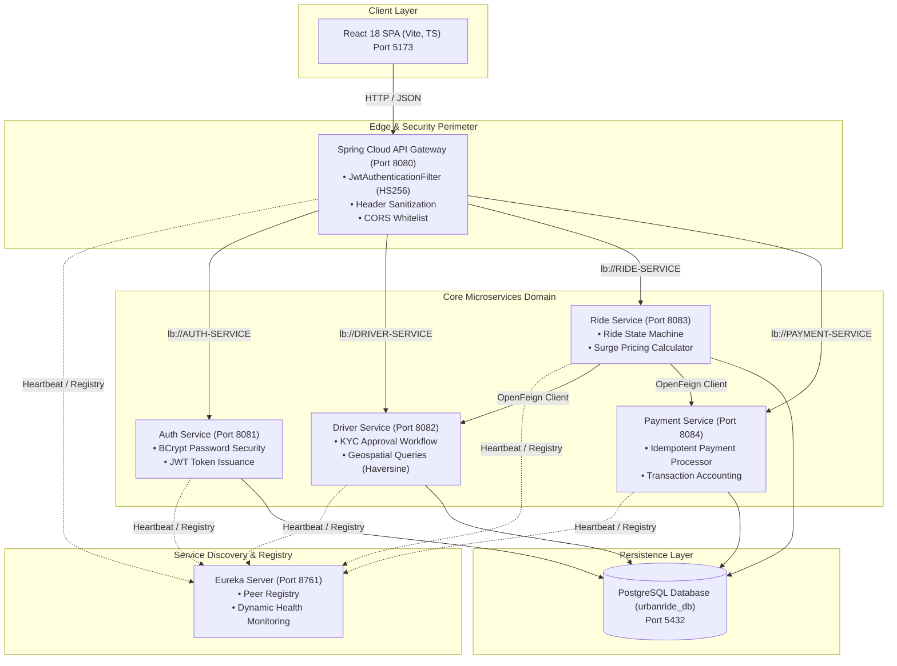
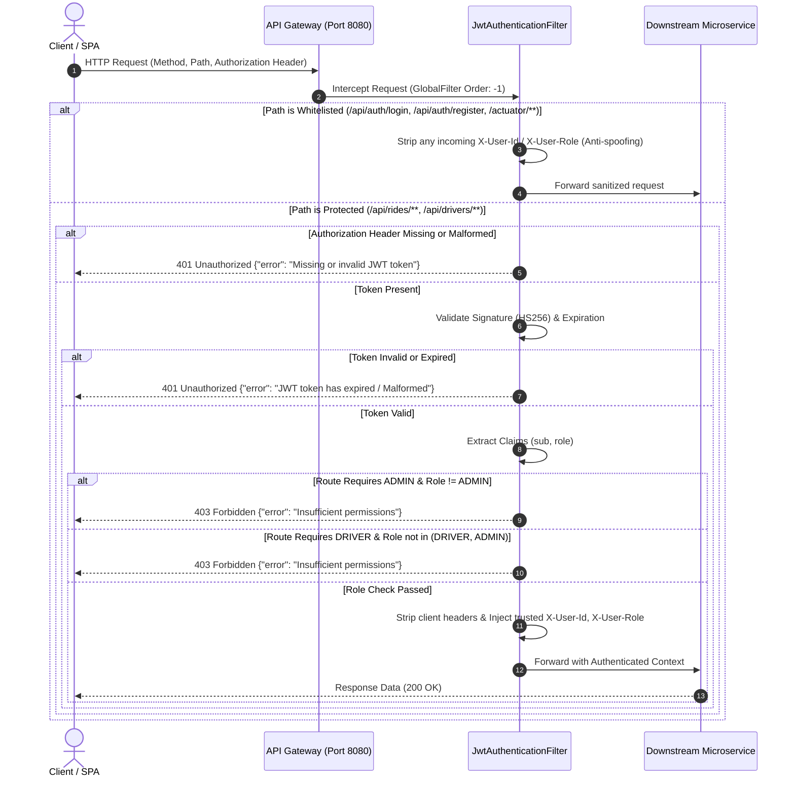
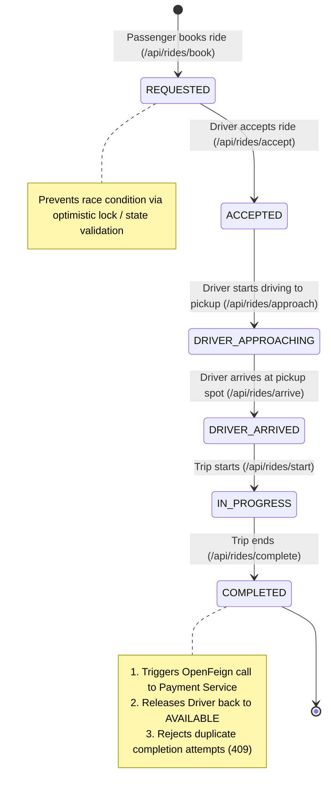
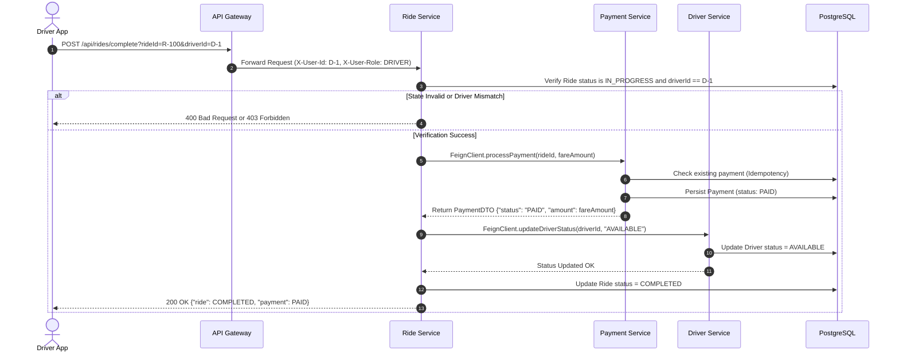
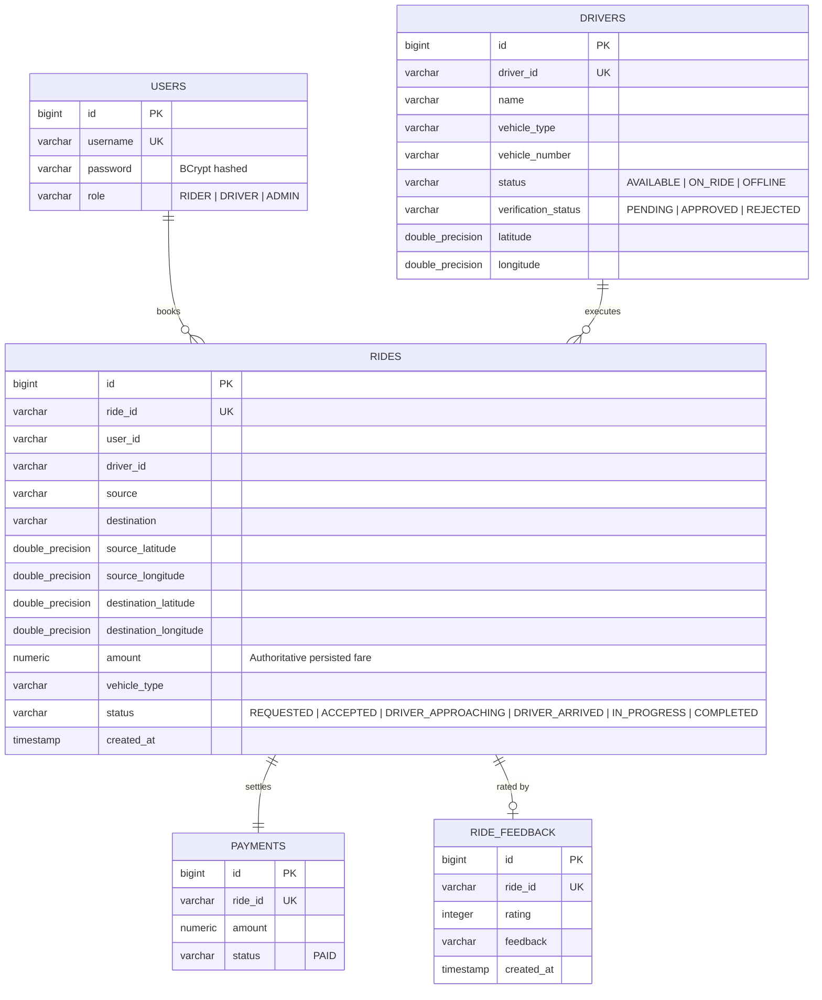

# UrbanGlide Review 2 — System Architecture & Design Specification

This document provides a comprehensive technical breakdown of the UrbanGlide microservices architecture, including network topology, sequence diagrams, security flow, and entity relationships.

---

## 1. High-Level System Architecture

---

## 2. API Gateway Security & JWT Filter Sequence

The API Gateway acts as an impermeable perimeter. All requests pass through `JwtAuthenticationFilter` before routing to downstream services.

---

## 3. End-to-End Ride Lifecycle State Machine

The Ride Service implements an authoritative state transition machine preventing concurrent races or invalid sequence bypass:

---

## 4. Inter-Service Communication (OpenFeign Synchronous Integration)

Upon trip completion, `RideService` communicates with `PaymentService` and `DriverService` via OpenFeign declarative REST clients:

---

## 5. Database Entity-Relationship Diagram

